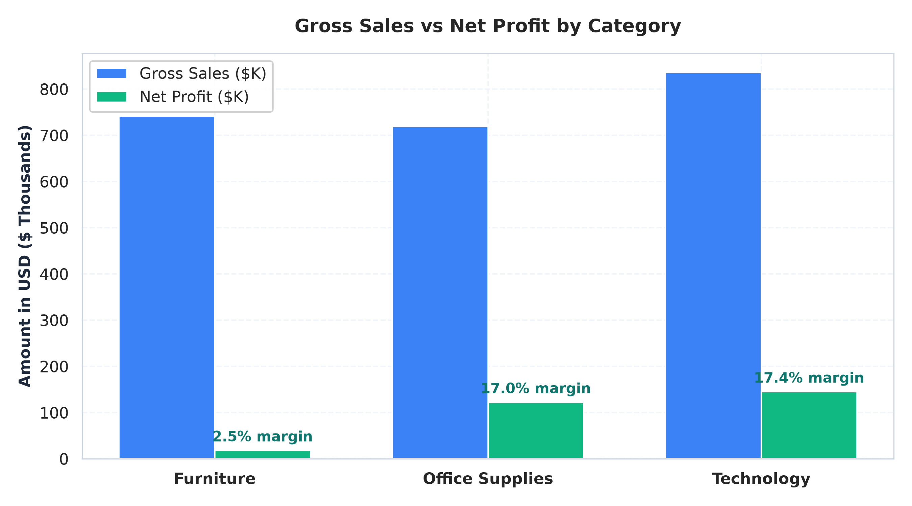
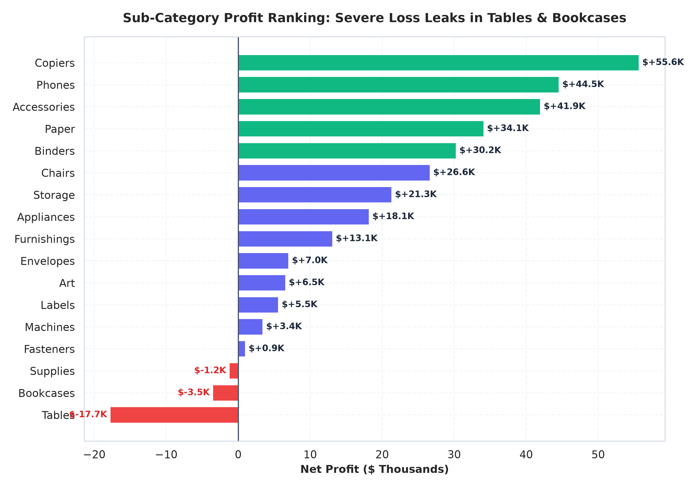
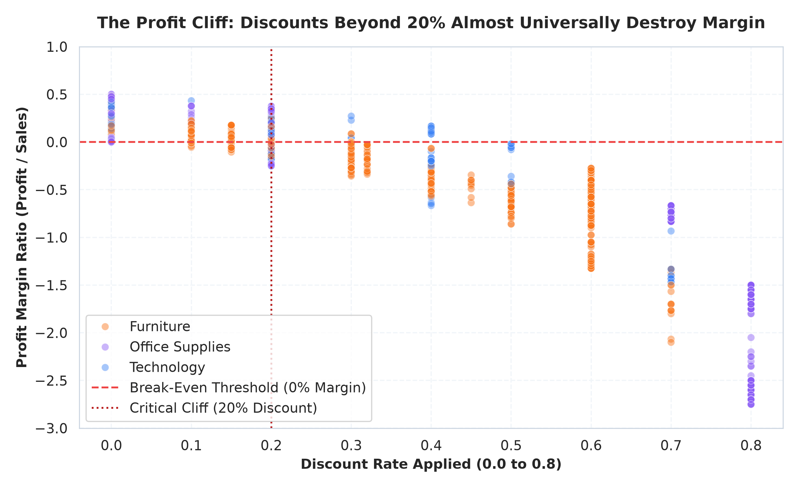
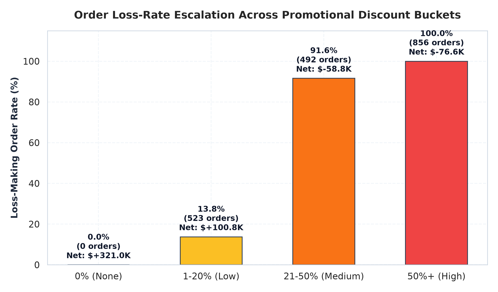
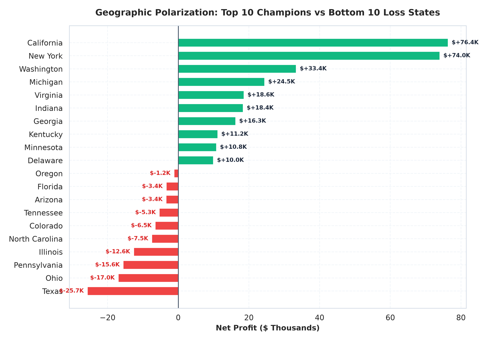
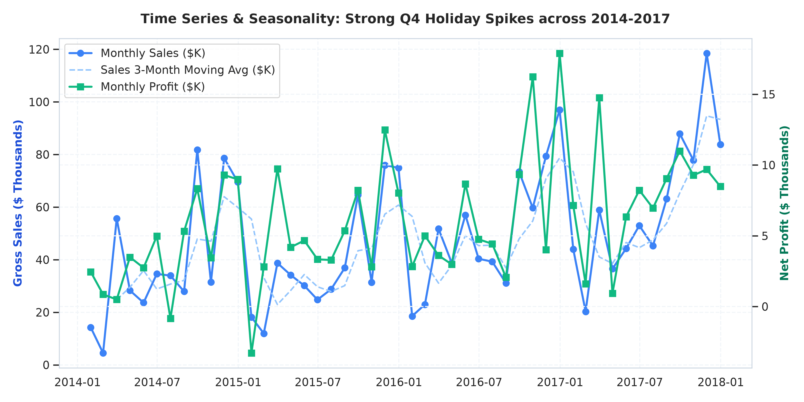

# 📊 Superstore Sales - Exploratory Data Analysis & Business Intelligence

[](https://www.python.org/)
[](https://pandas.pydata.org/)
[](https://plotly.com/)
[](https://streamlit.io/)
[]()

> An end-to-end data analytics and business intelligence solution diagnosing revenue growth, profit margin leaks, promotional discount tipping points, regional polarizations, and customer RFM lifetime value for the classic **Sample - Superstore** enterprise dataset.

---

## 📑 Table of Contents
1. [Executive Summary](#-executive-summary)
2. [Key Business Questions & Empirical Findings](#-key-business-questions--empirical-findings)
3. [Repository Architecture](#-repository-architecture)
4. [Data Engineering & Feature Store](#-data-engineering--feature-store)
5. [Visual Insights Gallery](#-visual-insights-gallery)
6. [Interactive Streamlit Dashboard](#-interactive-streamlit-dashboard)
7. [Strategic Recommendations & Financial Impact](#-strategic-recommendations--financial-impact)
8. [Getting Started & Reproducibility](#-getting-started--reproducibility)
9. [Tech Stack](#-tech-stack)

---

## 📌 Executive Summary
A nationwide retail enterprise recorded **9,994 transactions** generating **\$2,297,201 in gross revenue** and **\$286,397 in net profit** (**12.47% aggregate profit margin**) across 4 geographical regions and 3 product categories.

While top-line sales exhibited steady year-over-year expansion, diagnostic analysis revealed substantial capital destruction:
- **The 20% Discount Cliff:** Promotional discounts above 20% carry a **91.6% to 100% loss-making rate**, directly destroying **\$135,466 in net margin**.
- **Furniture Profit Drag:** Furniture generated \$742.0K in gross sales (32.3% of volume) but only \$18.5K in profit (2.49% margin) due to deep hemorrhaging in **Tables (-\$17.7K)** and **Bookcases (-\$3.5K)**.
- **Geographic Drainers:** Five states (**Texas, Ohio, Pennsylvania, Illinois, North Carolina**) accounted for **-\$78,359 in combined losses** driven by uncontrolled field discounting.
- **Simulated Opportunity:** Instituting a 20% promotional discount ceiling and restructuring loss-making tables projects a **+51.1% increase in net enterprise profit** (from \$286.4K to **\$432.6K**).

---

## ❓ Key Business Questions & Empirical Findings

| # | Business Question | Empirical Finding & Diagnosis | Strategic Takeaway |
|---|---|---|---|
| **Q1** | **Which categories/sub-categories drive profit and which lose money?** | **Technology** is the #1 profit driver (\$145.5K profit, 17.4% margin) led by Copiers (37.2% margin). **Furniture** severely underperforms (2.5% margin) due to **Tables (-\$17,725)** and **Bookcases (-\$3,473)**. | Discontinue bottom 10 chronic loss SKUs; impose cost-plus minimum margins on all furniture. |
| **Q2** | **How do discounts affect profit and margin?** | Undiscounted orders achieve **29.5% margin** (0% loss rate). Low discounts (1-20%) deliver **11.9% margin**. Discounts $>20\%$ experience an catastrophic **91.6% to 100% loss rate**. | Impose an automated pricing ceiling at 20% max discount across all standard transactions. |
| **Q3** | **Which regions and states underperform?** | **West** (\$108.4K profit, 14.9% margin) and **East** (\$91.5K profit) lead. **Central** lags at 7.9% margin. **Texas (-\$25.7K)**, **Ohio (-\$17.0K)**, and **PA (-\$15.6K)** are deep in the red. | Shift sales rep compensation from gross volume commissions to net profit margin contribution. |
| **Q4** | **Who are the most valuable customers and segments?** | **Home Office** yields the highest margin (**14.03%**). The top 20% of customer accounts generate **73.4% of total enterprise profit**. | Dedicated VIP retention programs for "Champions" and "Loyal Customers"; targeted re-engagement for "At Risk". |
| **Q5** | **What are the seasonality and growth patterns?** | Sales exhibit robust annual expansion peaking in **Q4** (November and December generate 28-32% of annual volume). | Pre-position high-margin inventory (Technology & Paper) 60 days in advance of the Q4 holiday surge. |
| **Q6** | **Does shipping mode affect delivery time or margin?** | **Standard Class** handles 59.7% of volume with an average 5.0-day turnaround. **First Class** delivers the highest margin (**13.93%**). | Pass-through actual freight costs for heavy freight furniture; retain premium tiers. |
| **Q7** | **Which products are sold at chronic losses?** | The top 10 loss SKUs (including *Chromcraft Round Conference Tables* and *Cubify 3D Printers*) account for thousands in direct margin drain. | Terminate chronic loss product IDs and reallocate shelf space to Copiers and Accessories. |
| **Q8** | **How can the business increase profit?** | Capping discounts at 20% and restructuring tables lifts profit from **\$286.4K to \$432.6K (+51.1%)**. | Execute the 4-phase governance and pricing policy outlined in the recommendations report. |

---

## 📂 Repository Architecture

```
superstore-sales-eda/
├── data/
│   ├── raw/
│   │   └── Sample - Superstore.csv        # Immutable raw transactional records (9,994 rows)
│   └── cleaned/
│       ├── superstore_cleaned.csv         # Validated, typed, and standardized baseline
│       ├── superstore_featured.csv        # Enriched with margins, temporal features & buckets
│       └── customer_rfm.csv               # Aggregated customer RFM segmentation metrics
├── notebooks/
│   ├── 01_cleaning.ipynb                  # Schema auditing, null handling & validation
│   ├── 02_features.ipynb                  # Feature engineering, margin logic & RFM scoring
│   ├── 03_eda.ipynb                       # Statistical exploration across all dimensions
│   └── 04_insights.ipynb                  # Business answers & profit sensitivity simulation
├── src/
│   ├── clean.py                           # Automated data cleaning pipeline
│   ├── features.py                        # Automated feature engineering pipeline
│   ├── generate_visuals.py                # Visual generation suite (300 DPI exports)
│   └── build_notebooks.py                 # Notebook generation and execution engine
├── dashboard/
│   └── app.py                             # Interactive executive Streamlit BI web app
├── visuals/                               # 9 Publication-quality charts (PNG 300 DPI)
│   ├── 01_sales_profit_by_category.png
│   ├── 02_subcategory_profitability.png
│   ├── 03_discount_vs_profit_margin.png
│   ├── 04_loss_rate_by_discount_bucket.png
│   ├── 05_state_profitability_top_bottom.png
│   ├── 06_monthly_sales_profit_trend.png
│   ├── 07_shipping_lead_time_by_mode.png
│   ├── 08_customer_rfm_segments.png
│   └── 09_correlation_matrix.png
├── docs/
│   ├── idea.md                            # Initial project ideation document
│   ├── PRD.md                             # Product Requirements Document & KPIs
│   ├── DATABASE.md                        # ER diagram, schema & feature store dictionary
│   └── AGENTS.md                          # Engineering standards & operational guidelines
├── reports/
│   └── business_recommendations.md        # Comprehensive executive strategic playbook
├── README.md                              # Main documentation and walkthrough
└── requirements.txt                       # Python dependencies
```

---

## 🔬 Data Engineering & Feature Store

### Cleaning Pipeline (`src/clean.py`)
- Standardized column names and stripped extraneous whitespace.
- Audited primary key (`Row ID`) uniqueness with 0 duplicates found.
- Formatted `Postal Code` as a clean 5-digit string with leading zeros; imputed missing Burlington, Vermont zip codes with `05401`.
- Verified temporal logic: validated that `Ship Date >= Order Date` holds across 100% of records.
- Enforced numeric integrity constraints: `Sales > 0`, `Quantity >= 1`, and `0.0 <= Discount <= 1.0`.

### Derived Feature Layer (`src/features.py`)
- `Profit_Margin`: $\text{Profit} / \text{Sales}$ (with zero division safeguard).
- `Is_Loss`: Boolean flag designating unprofitable transactions ($\text{Profit} < 0$).
- `Shipping_Days`: Lead time calculated as $\text{Ship Date} - \text{Order Date}$.
- `Order_Year`, `Order_Month`, `Order_Quarter`, `Order_Day_Name`, `Year_Month`: Granular temporal indicators.
- `Discount_Bucket`: Discrete commercial tiers (`0% (None)`, `1-20% (Low)`, `21-50% (Medium)`, `50%+ (High)`).
- `Effective_Unit_Price` & `Effective_Unit_Cost`: Granular per-unit unit economics.
- `Customer RFM Model`: Recency days, distinct order frequency, lifetime revenue/profit, and segment classification (`Champions`, `Loyal Customers`, `Potential Loyalists`, `Recent Customers`, `At Risk`, `Hibernating`).

---

## 🖼️ Visual Insights Gallery

### 1. Sales vs. Net Profit by Category
Technology and Office Supplies deliver consistent double-digit margins, while Furniture fails to translate volume into profit.


### 2. Sub-Category Profit Ranking
Tables (-\$17.7K) and Bookcases (-\$3.5K) represent massive margin leaks compared to Copiers (+\$55.6K) and Phones (+\$44.5K).


### 3. The 20% Discount Cliff
Orders discounted beyond 20% cross an immediate threshold into severe unprofitability.


### 4. Loss Rate by Promotional Tier
Loss-making order frequency escalates from 0% at full price to 91.6% in the medium tier and 100% at discounts $\ge 50\%$.


### 5. Geographic Champions vs. Loss Drainers
California and New York generate over \$150K in profit, while Texas, Ohio, and Pennsylvania drain over -\$58K.


### 6. Seasonality & Holiday Surges
Monthly revenue and profit trends display continuous year-over-year gains with concentrated surges in Q4.


---

## 💻 Interactive Streamlit Dashboard

The production dashboard (`dashboard/app.py`) provides executive decision-makers with real-time slicing and scenario simulation:

- **Executive KPI Cards:** Immediate visibility into Gross Sales, Net Profit, Profit Margin %, Loss-Making Item Rate, and Average Lead Time.
- **Dynamic Multi-Select Filters:** Slicing across Calendar Years, Regions, Customer Segments, Product Categories, and Discount Buckets.
- **Interactive Visuals:** Plotly dual-axis monthly trend lines, donut segment distributions, and interactive US State Choropleth maps.
- **SKU & Customer Ledgers:** Searchable tables of top 10 profit drivers and bottom 10 loss-making items.
- **Interactive Scenario Simulator:** Test profit lift under different discount caps (e.g. 15%, 20%, 25%) and table restructuring options.

### Running the Dashboard Locally:
```bash
# Activate virtual environment
source .venv/bin/activate

# Launch Streamlit app
streamlit run dashboard/app.py
```
Open [http://localhost:8501](http://localhost:8501) in your browser.

---

## 📈 Strategic Recommendations & Financial Impact

### Four Strategic Pillars
1. **Promotional Ceiling:** Cap field sales discounts at 20% max; permanently eliminate clearance discounting above 30%.
2. **Product Rationalization:** Discontinue the top 10 chronic loss-making furniture SKUs; enforce minimum basket sizes.
3. **Regional Realignment:** Transition sales representative commissions in Texas, Ohio, and Illinois from gross revenue to gross margin.
4. **Account Retention:** Prioritize VIP account management for high-margin Corporate and Home Office RFM Champions.

### Quantified Scenario Comparison
| Scenario | Gross Sales ($) | Net Profit ($) | Profit Margin (%) | Net Profit Lift ($) | % Lift |
|---|---|---|---|---|---|
| **Baseline (Current)** | \$2,297,201 | \$286,397 | 12.47% | Baseline | Baseline |
| **Strategy 1: 20% Discount Cap** | \$1,934,430 | \$421,863 | 21.81% | **+\$135,466** | **+47.3%** |
| **Strategy 2: Fix / Discontinue Tables** | \$2,090,235 | \$304,123 | 14.55% | **+\$17,725** | **+6.2%** |
| **Strategy 3: Combined Policy (1 + 2)** | **\$1,798,624** | **\$432,605** | **24.05%** | **+\$146,208** | **+51.1%** |

*Read the full executive report in [`reports/business_recommendations.md`](reports/business_recommendations.md).*

---

## 🚀 Getting Started & Reproducibility

### 1. Clone & Set Up Environment
```bash
git clone https://github.com/<your-username>/superstore-sales-eda.git
cd superstore-sales-eda

# Create and activate virtual environment
virtualenv .venv
source .venv/bin/activate

# Install dependencies
pip install -r requirements.txt
```

### 2. Execute Data Pipeline
```bash
# 1. Clean raw data
python src/clean.py

# 2. Derive features and customer RFM
python src/features.py

# 3. Generate high-resolution visuals
python src/generate_visuals.py
```

### 3. Run Notebooks
All 4 notebooks can be opened and re-executed in Jupyter Lab:
```bash
jupyter lab notebooks/
```
Or rebuild them programmatically with executed outputs:
```bash
python src/build_notebooks.py
```

---

## 🛠️ Tech Stack
- **Language:** Python 3.12
- **Data Manipulation:** pandas 3.1, NumPy
- **Visualizations:** Matplotlib 3.11, Seaborn 0.13, Plotly 7.1
- **Dashboard Application:** Streamlit 1.66
- **Notebook Environment:** JupyterLab, nbclient, nbformat
- **Documentation & Modeling:** GitHub Flavored Markdown, Mermaid.js
