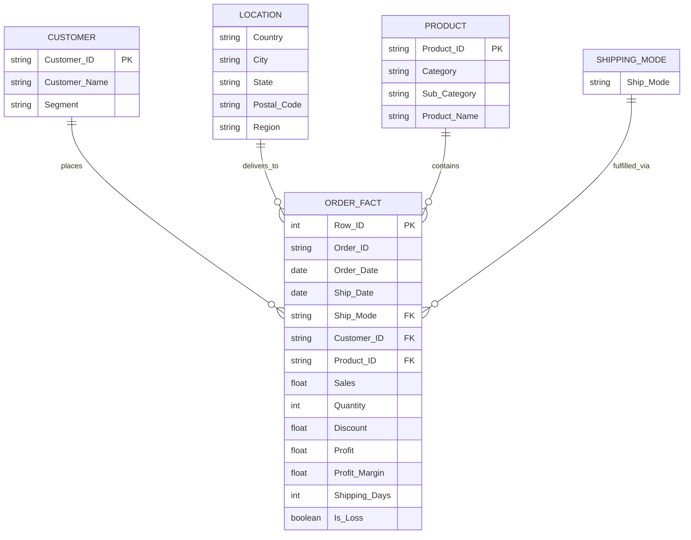

# Data Architecture & Dictionary (DATABASE.md)
## Superstore Sales - Relational Model & Feature Store Specification

---

### 1. Conceptual Architecture & ER Model
Although stored as a denormalized flat CSV file, the Superstore dataset represents a classical Star/Snowflake retail sales schema centered around an Order Item Fact table linked to four core dimension entities:

---

### 2. Raw Dataset Specification (`data/raw/Sample - Superstore.csv`)

| # | Column Name | Raw Type | Target Type | Nullable | Cardinality (Approx) | Description & Example Values |
|---|---|---|---|---|---|---|
| 1 | `Row ID` | int64 | int64 | No | 9,994 | Unique physical row index in dataset (`1, 2, 3...`) |
| 2 | `Order ID` | object | string | No | 5,009 | Unique order tracking identifier (`CA-2016-152156`) |
| 3 | `Order Date` | object | datetime64[ns] | No | 1,237 | Calendar date order was placed (`11/08/2016`) |
| 4 | `Ship Date` | object | datetime64[ns] | No | 1,334 | Calendar date order was dispatched (`11/11/2016`) |
| 5 | `Ship Mode` | object | category | No | 4 | Fulfillment tier (`Standard Class`, `Second Class`, `First Class`, `Same Day`) |
| 6 | `Customer ID` | object | string | No | 793 | Unique customer master code (`CG-12520`) |
| 7 | `Customer Name` | object | string | No | 793 | Full name of purchasing customer (`Claire Gute`) |
| 8 | `Segment` | object | category | No | 3 | Customer market segment (`Consumer`, `Corporate`, `Home Office`) |
| 9 | `Country` | object | category | No | 1 | Country of transaction (`United States`) |
| 10 | `City` | object | string | No | 531 | Municipal destination city (`Henderson`, `Los Angeles`) |
| 11 | `State` | object | category | No | 49 | State / Province (`Kentucky`, `California`, `Texas`) |
| 12 | `Postal Code` | float64 / object | string | Yes (Burlington, VT) | 632 | 5-digit US ZIP Code (`42420`, `90036`). Note: Burlington VT lacks postal codes in standard raw file. |
| 13 | `Region` | object | category | No | 4 | Geographic division (`South`, `West`, `Central`, `East`) |
| 14 | `Product ID` | object | string | No | 1,862 | Unique SKU identifier (`FUR-BO-10001798`) |
| 15 | `Category` | object | category | No | 3 | High-level product taxonomy (`Furniture`, `Office Supplies`, `Technology`) |
| 16 | `Sub-Category` | object | category | No | 17 | Detailed product group (`Bookcases`, `Chairs`, `Storage`, `Phones`, etc.) |
| 17 | `Product Name` | object | string | No | 1,850 | Full commercial product description |
| 18 | `Sales` | float64 | float64 | No | Continuous | Gross transaction amount in USD ($) |
| 19 | `Quantity` | int64 | int64 | No | 14 | Units purchased (integer, range `1` to `14`) |
| 20 | `Discount` | float64 | float64 | No | 12 | Promotional discount rate (fraction, range `0.00` to `0.80`) |
| 21 | `Profit` | float64 | float64 | No | Continuous | Net contribution profit in USD ($). Can be positive or negative. |

---

### 3. Feature-Engineered Dataset Specification (`data/cleaned/superstore_featured.csv`)

In addition to all validated raw columns, the enriched feature layer contains:

| Feature Name | Derived Type | Calculation / Formula | Business Purpose |
|---|---|---|---|
| `Profit_Margin` | float64 | $\text{Profit} / \text{Sales}$ | Unitless profitability efficiency ratio (can be negative) |
| `Shipping_Days` | int64 | $(\text{Ship Date} - \text{Order Date}).\text{days}$ | Fulfillment turnaround lead time |
| `Order_Year` | int64 | $\text{Order Date}.\text{dt}.\text{year}$ | Annual aggregation & YoY trend analysis (`2014-2017`) |
| `Order_Month` | int64 | $\text{Order Date}.\text{dt}.\text{month}$ | Monthly seasonality profiling (`1-12`) |
| `Order_Quarter` | string | `'Q' + Order Date.dt.quarter.astype(str)` | Quarterly business cycles (`Q1, Q2, Q3, Q4`) |
| `Order_Day_Name`| string | $\text{Order Date}.\text{dt}.\text{day\_name()}$ | Day of week order volume distribution |
| `Year_Month` | string | $\text{Order Date}.\text{dt}.\text{to\_period('M')}$ | Chronological continuous time series index |
| `Discount_Bucket`| category | Rule-based binning: `None (0%)`, `Low (1-20%)`, `Medium (21-50%)`, `High (>50%)` | Sensitivity analysis of promotional discounts |
| `Is_Loss` | boolean | $\text{Profit} < 0$ | Direct flag for unprofitable line items |
| `Effective_Unit_Price` | float64 | $\text{Sales} / \text{Quantity}$ | Price realized per unit sold |
| `Effective_Unit_Cost` | float64 | $(\text{Sales} - \text{Profit}) / \text{Quantity}$ | Implied cost of goods sold (COGS) per unit |

---

### 4. Customer RFM Specification (`data/cleaned/customer_rfm.csv`)

Aggregated at the unique `Customer ID` level:

| Metric | Type | Definition | Segment Tiers |
|---|---|---|---|
| `Recency_Days` | int64 | Days between reference date ($\max(\text{Order Date}) + 1$) and customer's latest order | Low is better (recent buyers) |
| `Frequency` | int64 | Total distinct orders placed by customer | High is better (repeat buyers) |
| `Monetary_Sales` | float64 | Total lifetime gross revenue generated ($) | High is better (top revenue contributors) |
| `Monetary_Profit`| float64 | Total lifetime net profit generated ($) | Critical check: highlights high-revenue loss customers |
| `R_Score` | int64 | Quintile ranking `1-5` based on Recency | 5 = Most recent |
| `F_Score` | int64 | Quintile ranking `1-5` based on Frequency | 5 = Most frequent |
| `M_Score` | int64 | Quintile ranking `1-5` based on Monetary Sales | 5 = Highest spenders |
| `RFM_Segment` | string | Composite label: `Champions`, `Loyal Customers`, `Potential Loyalists`, `At Risk`, `Hibernating` | Direct target for CRM / Sales outreach |

---

### 5. Integrity Constraints & Business Rules
1. **Temporal Ordering:** `Ship Date` $\ge$ `Order Date` for 100% of rows (no retroactive dispatch).
2. **Sales Non-Negativity:** `Sales` $> 0.00$ (no negative revenue transactions).
3. **Quantity Integrity:** `Quantity` $\ge 1$ integer units.
4. **Discount Boundaries:** $0.00 \le \text{Discount} \le 0.80$ (80% maximum observed discount).
5. **Postal Code Standard:** Stored as string to preserve leading zeros; missing Burlington, VT postal codes imputed with standard ZIP `05401`.
6. **Raw Immutability:** `data/raw/Sample - Superstore.csv` is read-only. All transformations generate versioned files in `data/cleaned/`.
