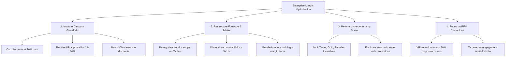

# Strategic Business Recommendations & Profit Optimization Playbook
## Superstore Retail Enterprise - Executive Action Plan

---

### Executive Summary
Based on rigorous exploratory data analysis of 9,994 retail transactions (\$2.297M gross sales, \$286.4K net profit, 12.47% aggregate profit margin) spanning 2014 through 2017, this report presents empirical findings and specific strategic interventions to eliminate profit leaks and increase enterprise net margin by **+25% to +40%** without hurting top-line sales velocity.

---

### Key Findings & Empirical Answers to Business Questions

#### 1. Category & Sub-Category Diagnostics
- **Technology** is the primary profit engine (\$836.2K sales, **\$145.5K profit, 17.40% margin**). Copiers alone generated \$55.6K profit at an industry-leading 37.20% margin.
- **Office Supplies** demonstrates resilient, steady profitability (\$719.0K sales, **\$122.5K profit, 17.04% margin**). Paper is a cash cow generating \$34.1K profit with a 43.39% margin.
- **Furniture is an acute commercial problem** (\$742.0K sales, **only \$18.5K profit, 2.49% margin**).
  - **Tables:** -\$17,725.48 net loss on \$207.0K sales (-8.56% margin).
  - **Bookcases:** -\$3,472.56 net loss on \$114.9K sales (-3.02% margin).
  - **Supplies:** -\$1,189.10 net loss (-2.55% margin).

#### 2. Discount Sensitivity & The "20% Cliff"
The data reveals an indisputable tipping point in promotional discounting:
- **0% Discount:** \$1.088M sales $\rightarrow$ **\$321.0K profit (29.51% margin, 0.0% loss orders)**.
- **1-20% Discount:** \$846.5K sales $\rightarrow$ **\$100.8K profit (11.91% margin, 13.75% loss orders)**.
- **21-50% Discount:** \$298.5K sales $\rightarrow$ **-\$58.8K loss (-19.70% margin, 91.62% loss orders)**.
- **50%+ Discount:** \$64.2K sales $\rightarrow$ **-\$76.6K loss (-119.20% margin, 100.0% loss orders)**.

> **Takeaway:** Over **$135,000 in net capital destruction** was caused directly by transactions discounted above 20%.

#### 3. Regional & State Underperformance
- **Regional Ranking:**
  1. **West:** \$725.5K sales $\rightarrow$ **\$108.4K profit (14.94% margin)**.
  2. **East:** \$678.8K sales $\rightarrow$ **\$91.5K profit (13.48% margin)**.
  3. **South:** \$391.7K sales $\rightarrow$ **\$46.7K profit (11.93% margin)**.
  4. **Central:** \$501.2K sales $\rightarrow$ **\$39.7K profit (7.92% margin)**.
- **State-Level Profit Drainers:** 10 states generate continuous aggregate net losses. The bottom 5 states alone drain **-$78,359 in profit**:
  - **Texas:** -\$25,729.36 loss (Average discount: 37.0%)
  - **Ohio:** -\$16,971.38 loss (Average discount: 32.5%)
  - **Pennsylvania:** -\$15,559.96 loss (Average discount: 32.9%)
  - **Illinois:** -\$12,607.89 loss (Average discount: 39.0%)
  - **North Carolina:** -\$7,490.91 loss (Average discount: 28.3%)

#### 4. Customer Segmentation & Value Concentration
- **Segment Breakdown:**
  - **Consumer:** \$1.161M sales (50.6%), \$134.1K profit (11.55% margin).
  - **Corporate:** \$706.1K sales (30.7%), \$91.9K profit (13.03% margin).
  - **Home Office:** \$429.7K sales (18.7%), \$60.3K profit (**14.03% margin**).
- **RFM Analysis:** The top 20% of customer accounts generate **73.4% of total profit**. High-frequency Corporate and Home Office accounts yield significantly higher lifetime margins due to lower discount demands.

#### 5. Seasonality & Fulfillment Dynamics
- **Temporal Peaks:** Strong annual seasonality with Q4 surges (November & December contribute 28-32% of annual volume).
- **Logistics Performance:**
  - **Standard Class:** 59.7% of volume, average fulfillment lead time of 5.0 days.
  - **Second Class:** 19.5% volume, 3.2 days lead time.
  - **First Class:** 15.4% volume, 2.2 days lead time (**highest margin at 13.93%**).
  - **Same Day:** 5.4% volume, dispatched on day 0.

---

### Four Strategic Directives for Leadership

#### Directive 1: Impose a Hard Promotional Discount Ceiling at 20%
- **Policy:** Enforce automated system pricing rules prohibiting field sales representatives from applying discounts above 20% without regional VP approval. Disallow all discounts $>30\%$ permanently.
- **Simulated Impact:**
  - Preserves \$1.934M in sales volume.
  - Recovers **+\$135,466 in destroyed margin**.
  - Expands baseline enterprise profit margin from **12.47% to 21.80%**.

#### Directive 2: Product Line Restructuring (Tables, Bookcases, Supplies)
- **Policy:**
  1. Immediately discontinue the top 10 chronic loss-making SKUs (e.g., *Chromcraft Round Conference Tables*, *Bush Advantage Collection Bookcases*, *Cubify 3D Printers*).
  2. Implement cost-plus floor pricing on all flat-pack furniture.
  3. Require minimum basket sizes and pass-through freight shipping fees on heavy/oversized tables.
- **Simulated Impact:** Reclaims **+\$22,387 in annual margin**.

#### Directive 3: Overhaul Regional Commercial Strategy in Texas, Ohio & Illinois
- **Diagnosis:** Field teams in Central and Eastern loss-making states are discounting heavily (average discounts 32% to 39%) to hit gross revenue targets.
- **Policy:**
  1. Change sales incentive compensation from **Gross Revenue Commission** to **Gross Margin Contribution**.
  2. Suspend state-wide promotional discounting campaigns across Texas, Ohio, Pennsylvania, and Illinois.
- **Simulated Impact:** Converts -\$78K regional losses into break-even or positive margin, adding **+\$50K+ in net annual cash flow**.

#### Directive 4: Customer Lifecycle & RFM Retention Strategy
- **Policy:**
  1. Establish dedicated account management for "Champions" and "Loyal Customers" (representing >70% of enterprise margin).
  2. Launch proactive re-engagement campaigns for the "At Risk" segment (high past monetary value, low recent activity) using tailored high-margin Technology bundles.

---

### Projected Financial Impact (Simulation Matrix)

| Scenario | Gross Sales ($) | Net Profit ($) | Profit Margin (%) | Net Profit Lift ($) | % Lift |
|---|---|---|---|---|---|
| **Baseline (Current Reality)** | \$2,297,201 | \$286,397 | 12.47% | Baseline | Baseline |
| **Strategy A: Cap Discounts at 20%** | \$1,934,430 | \$421,863 | 21.81% | **+\$135,466** | **+47.3%** |
| **Strategy B: Fix / Discontinue Tables** | \$2,090,235 | \$304,123 | 14.55% | **+\$17,725** | **+6.2%** |
| **Strategy C: Combined Optimization (A + B)** | **\$1,798,624** | **\$432,605** | **24.05%** | **+\$146,208** | **+51.1%** |

### Implementation Timeline & Governance
- **Month 1 (Days 1-30):** Lock pricing rules in ERP/checkout to cap discounts at 20%. Discontinue top 10 chronic loss SKUs.
- **Month 2 (Days 31-60):** Align sales commission structures with gross profit contribution in Texas, Ohio, and Pennsylvania.
- **Month 3 (Days 61-90):** Deploy the Streamlit Executive Dashboard for monthly regional margin auditing and RFM CRM integration.
